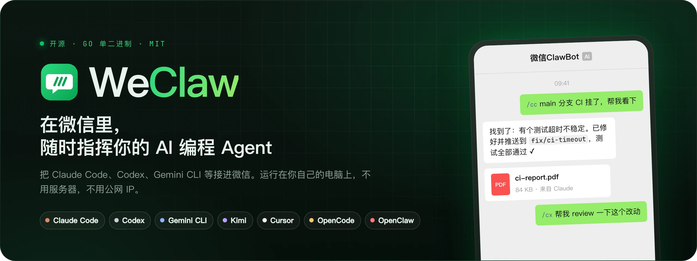
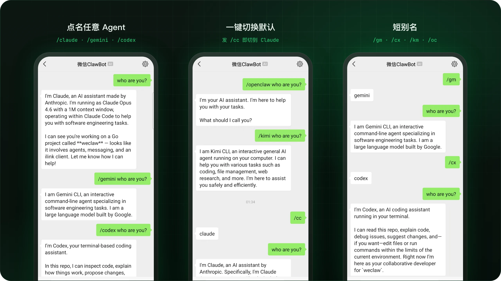
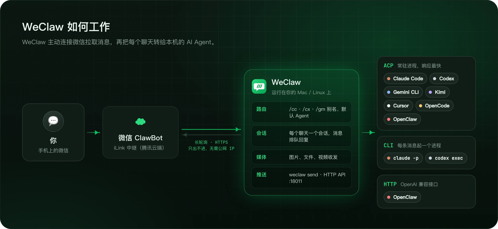

<p align="center">
  
</p>

<h1 align="center">WeClaw：把 Claude Code、Codex 等 AI 编程 Agent 接进微信</h1>

<p align="center">
  <a href="https://github.com/Tespera/weclaw/releases"></a>
  <a href="go.mod"></a>
  <a href="LICENSE"></a>
  
  
</p>

<p align="center">
  <a href="README.md">English</a> · <b>简体中文</b> ·
  <a href="#快速开始">快速开始</a> ·
  <a href="#工作原理">工作原理</a> ·
  <a href="#常见问题">常见问题</a> ·
  <a href="CHANGELOG.md">更新日志</a>
</p>

**WeClaw** 是一个开源的微信 AI Agent 桥接器，把**微信**接到你自己电脑上的 AI 编程 Agent。在手机上发一条微信，**Claude Code**、**OpenAI Codex**、**Gemini CLI**、**Kimi**、**Cursor**、**OpenCode**、**OpenClaw** 就会回答问题、改代码、跑命令，还能把文件发回给你。它基于微信 ClawBot（iLink）协议，是一个 Go 单二进制；Claude 通过 [Agent Client Protocol](https://agentclientprotocol.com/)（ACP）接入，使用 [`claude-agent-acp`](https://www.npmjs.com/package/@agentclientprotocol/claude-agent-acp)。

> [!NOTE]
> **这是 [fastclaw-ai/weclaw](https://github.com/fastclaw-ai/weclaw) 的持续维护版。** 上游自 2026-04 起没有新提交，本仓库基于上游 v0.7.1 继续修 bug、加功能。配置和登录数据（`~/.weclaw`）与上游通用，可以直接替换。见[相比上游修了什么](#相比上游修了什么)。

## 亮点

- **主流编程 Agent 都在一个聊天里**：Claude Code、Codex、Gemini CLI、Kimi、Cursor、OpenCode、OpenClaw，另外通过 ACP 支持 GitHub Copilot CLI、Qwen Code、Kiro、Factory Droid、iFlow、pi。用 `/codex …` 点名，或用 `/cc` 这样的短别名切换默认 Agent。
- **跑在你自己的电脑上，不用服务器**：WeClaw 主动用 HTTPS 长轮询微信，不需要公网 IP、端口映射或云主机，代码始终留在本机。
- **真正的会话，不是一问一答**：每个聊天各有一个 Agent 会话；上一条还没回完时发的消息会排队，不会丢；`/new` 开新会话，`/cwd` 切换项目。
- **文件双向收发**：可以把图片、PDF、视频发给 Agent，Agent 也能用 `weclaw send --media` 把截图、报告或任意本地文件发回给你。
- **Agent 能主动通知你**：长任务跑完后，可以通过 `weclaw send` 命令或本机 HTTP API 给你发微信。
- **长期稳定运行**：macOS 登录服务（launchd）、单实例锁、崩溃自动拉起；重启打断的回复会提示你重发。
- **报错说人话**：网络中断、额度用完（附恢复时间）、登录失效等都用中文讲清楚，不甩原始报错。

<p align="center">
  
</p>

## 快速开始

需要 Go 1.25+。主要在 macOS 上使用和测试；Linux 可以编译运行（需自行用 systemd 托管），Windows 能编译但未测试。

```bash
git clone https://github.com/Tespera/weclaw.git
cd weclaw

# 编译并安装到 ~/.local/bin（可用 PREFIX 覆盖），确保它在 PATH 里
make install

# 首次启动：弹出微信扫码登录，之后后台运行
weclaw start

# 推荐（macOS）：注册为登录服务（开机自启、崩溃自动拉起）
weclaw service install
```

之后用 `weclaw update` 拉取最新代码并重新安装。

首次启动时，WeClaw 会：

1. 显示二维码，用微信扫码登录
2. 自动检测已安装的 AI Agent（Claude、Codex、Gemini 等）
3. 保存配置到 `~/.weclaw/config.json`
4. 开始接收和回复微信消息

使用 `weclaw login` 可以添加更多微信账号。

用 Claude 的话推荐 ACP 模式：`npm i -g @agentclientprotocol/claude-agent-acp`，配置见[ACP 会话选项与环境变量](#acp-会话选项与环境变量)。

### 从上游 fastclaw-ai/weclaw 迁移

配置和登录数据都在 `~/.weclaw`，格式兼容，不用重新扫码。

1. 停掉旧版本：`weclaw stop`
2. 删除旧二进制，避免 PATH 里先找到它：上游 `install.sh` 默认装在 `/usr/local/bin/weclaw`，`go install` 装在 `$(go env GOPATH)/bin/weclaw`
3. 按上面的「快速开始」安装并 `weclaw start`
4. 用 Claude 的话，建议改用 ACP：`npm i -g @agentclientprotocol/claude-agent-acp`，配置见下文「ACP 会话选项与环境变量」

## 工作原理

<p align="center">
  
</p>

你在微信里和 ClawBot 聊天；运行在你电脑上的 WeClaw 通过长轮询从 ClawBot 中继拉取新消息，交给对应的 Agent，再原路把回复发回来。每个微信聊天对应一个独立的 Agent 会话。

**Agent 接入模式：**

| 模式 | 工作方式 | 支持的 Agent |
| ---- | -------- | ------------ |
| ACP  | 长驻子进程，通过 stdio JSON-RPC 通信。速度最快，复用进程和会话。 | Claude、Codex、Kimi、Gemini、Cursor、OpenCode、OpenClaw、Copilot、Qwen、Kiro、Droid、iFlow、pi |
| CLI  | 每条消息启动一个新进程，支持通过 `--resume` 恢复会话。 | Claude（`claude -p`）、Codex（`codex exec`） |
| HTTP | OpenAI 兼容的 Chat Completions API。 | OpenClaw（HTTP 回退） |

同时存在 ACP 和 CLI 时，自动优先选择 ACP。

## 相比上游修了什么

上游 issue 里的这些问题，在本仓库已解决：

| 问题 | 上游 issue | 本仓库 |
| ---- | ---------- | ------ |
| 上一条还没回完就发下一条，前一条被打断或报 `agent returned empty response` | [#48](https://github.com/fastclaw-ai/weclaw/issues/48) | 同一会话的消息排队依次处理，每条各自回复（v0.9.5，ACP 模式） |
| Codex 下 `/new` 报 `unknown variant session/new` | [#60](https://github.com/fastclaw-ai/weclaw/issues/60) | 已修复（v0.9.0） |
| 不能把本机的图片、文件发回微信 | [#57](https://github.com/fastclaw-ai/weclaw/issues/57)、[#34](https://github.com/fastclaw-ai/weclaw/issues/34) | `weclaw send --media <本地路径>`，任意文件类型；Agent 会被告知用它发文件（v0.9.3、v0.9.4） |
| 微信发图片、文件给 Agent 没反应 | [#26](https://github.com/fastclaw-ai/weclaw/issues/26) | 图片、文件、视频保存到本机，随下一条消息把路径交给 Agent（v0.9.9） |
| 切换默认 Agent 会覆盖磁盘上的新配置 | [#38](https://github.com/fastclaw-ai/weclaw/issues/38) | 只改 `default_agent` 字段（v0.9.0） |

另外还有：

- **配合官方 `claude-agent-acp` 能正常用工具**：上游只认 `allow` 这种审批选项，官方适配器给的是 `allow_once` / `allow_always`，结果所有需要审批的工具都被拒绝。
- **`model` / `mode` 配置对 Claude 生效**：通过 ACP 标准的 `session/set_config_option` 设置，`mode: bypassPermissions` 等价于 `claude --dangerously-skip-permissions`。
- **单实例锁 + macOS 登录服务**：`weclaw service install` 注册 launchd，开机自启、崩溃拉起；两个实例不会再抢同一个消息队列。
- **重启不吞回复**：回复生成到一半时 weclaw 重启（更新、`weclaw restart`，包括在微信里让 Agent 执行），重启后会提示该聊天重新发送，不再石沉大海；`/new`、`/cwd` 也会关掉旧会话的 Claude Code 进程。
- **`/new 消息`** 新建会话并直接提问；`/cwd` 立即生效并写回配置。
- 每个会话自动带上微信场景说明，`system_prompt` 追加到 Claude Code 自带的系统提示之后，而不是替换它。

完整列表见 [CHANGELOG.md](CHANGELOG.md)。

## 聊天命令

在微信中发送以下命令：

| 命令                    | 说明                     |
| ----------------------- | ------------------------ |
| `你好`                  | 发送给默认 Agent         |
| `/codex 写一个排序函数` | 发送给指定 Agent         |
| `/cc 解释一下这段代码`  | 通过别名发送             |
| `/claude`               | 切换默认 Agent 为 Claude |
| `/cwd /path/to/project` | 切换工作区：所有 Agent 生效、写回配置，并立即新建会话 |
| `/cwd`                  | 查看当前工作区 |
| `/new`                  | 开始新对话（清除会话）   |
| `/new 帮我看下这个报错` | 开始新对话并直接发送这条消息 |
| `/info`                 | 查看当前 Agent 信息（含工作区） |
| `/help`                 | 查看帮助信息             |

### 快捷别名

| 别名   | Agent    |
| ------ | -------- |
| `/cc`  | Claude   |
| `/cx`  | Codex    |
| `/cs`  | Cursor   |
| `/km`  | Kimi     |
| `/gm`  | Gemini   |
| `/ocd` | OpenCode |
| `/oc`  | OpenClaw |

也可以在配置文件中为每个 Agent 自定义触发命令：

```json
{
  "agents": {
    "claude": {
      "type": "acp",
      "aliases": ["ai", "c"]
    }
  }
}
```

然后 `/ai 你好` 或 `/c 你好` 就会路由到 claude。

切换默认 Agent 会写入配置文件，重启后仍然生效。

## 富媒体消息

WeClaw 支持收发图片、视频、文件和语音消息。

**语音消息：** 在微信中发送语音消息时，WeClaw 会自动使用微信的语音转文字功能，将转写后的文本发送给 AI Agent。重复的语音消息事件会自动去重。

**收到的图片、文件、视频：** 保存到 `~/.weclaw/workspace/inbox/<日期>/`，先回一句"已收到"，再随用户下一条消息把本地路径一起交给 Agent（微信里通常先发文件、再说要做什么）。单个文件上限 200 MB。

**报错：** Agent 出错时回复中文说明（发生了什么、是不是你这边的问题、下一步怎么做），如额度用完会给出恢复时间；原始报错只写日志。

**Agent 回复中的图片：** 当 AI Agent 返回包含图片的 markdown（``）时，WeClaw 会自动提取图片 URL，下载文件，上传到微信 CDN（AES-128-ECB 加密），然后作为图片消息发送。

**Markdown 转换：** Agent 的回复会自动从 markdown 转为纯文本再发送 — 代码块去掉围栏、链接只保留文字、加粗斜体标记去除等。

## 主动推送消息

无需等待用户发消息，主动向微信用户推送消息。

**命令行：**

```bash
# 发送文本
weclaw send --to "user_id@im.wechat" --text "你好，来自 weclaw"

# 发送图片
weclaw send --to "user_id@im.wechat" --media "https://example.com/photo.png"

# 发送文本 + 图片
weclaw send --to "user_id@im.wechat" --text "看看这个" --media "https://example.com/photo.png"

# 发送文件
weclaw send --to "user_id@im.wechat" --media "https://example.com/report.pdf"

# 发送本地文件（任意类型；支持 ~、相对路径、file://；--media 可重复）
weclaw send --to "user_id@im.wechat" --media ~/Desktop/report.pdf --media ./chart.png
```

所有 `--media` 会先校验（文件存在且是普通文件），全部通过后才开始发送，不会只发出一半。

**HTTP API**（`weclaw start` 运行时，默认监听 `127.0.0.1:18011`）：

```bash
# 发送文本
curl -X POST http://127.0.0.1:18011/api/send \
  -H "Content-Type: application/json" \
  -d '{"to": "user_id@im.wechat", "text": "你好，来自 weclaw"}'

# 发送图片
curl -X POST http://127.0.0.1:18011/api/send \
  -H "Content-Type: application/json" \
  -d '{"to": "user_id@im.wechat", "media": "https://example.com/photo.png"}'

# 发送本地文件（必须是绝对路径）
curl -X POST http://127.0.0.1:18011/api/send \
  -H "Content-Type: application/json" \
  -d '{"to": "user_id@im.wechat", "media": "/Users/me/Desktop/report.pdf"}'

# 发送文本 + 媒体
curl -X POST http://127.0.0.1:18011/api/send \
  -H "Content-Type: application/json" \
  -d '{"to": "user_id@im.wechat", "text": "看看这个", "media": "https://example.com/photo.png"}'
```

`media` 接受网址或本地绝对路径（旧字段 `media_url` 仍可用）。本地路径只接受来自本机（127.0.0.1 / ::1）的请求，即使把 API 绑到了其他地址也不会让远程调用读取本地文件。

媒体按类型发送：图片（png、jpg、gif、webp、bmp）按图片发，视频（mp4、mov、webm、mkv、avi）按视频发，其余任意类型按文件发。

设置 `WECLAW_API_ADDR` 环境变量可更改监听地址（如 `0.0.0.0:18011`）。

> [!IMPORTANT]
> 微信只在用户最近一次给机器人发消息后约 24 小时内允许机器人主动推送；你不回复时，机器人最多连发约 10 条。超出后发送报 `ret=-2 errmsg=prepare failed`，给机器人随便发一句话即可重新打开。这两个数字是实测值，腾讯没有公开文档。

weclaw 为此做了几件事：

- **带上会话令牌**：bridge 把你每条消息带来的 context token 存到 `~/.weclaw/state/`，`weclaw send` 和 HTTP API 发送时带上它；被拒时再不带令牌试一次。
- **待发箱**：被微信拒绝、或连不上微信服务器（已自动重试约 40 秒）的消息不会丢，存进待发箱；你下次给机器人发消息时先补发（多条文字合并成一条），网络恢复后若窗口还开着也会自动补发。超过 7 天的丢弃。`--no-queue`（API 里 `"no_queue": true`）可关闭。
- **到期提醒**：窗口关闭前约 4 小时，机器人提醒你回一句；落在免打扰时段（默认 23:00–08:00）就提前到前一晚 22:30。提醒发出后你回复的 4 个字以内的短消息只用来续期，不会转给 AI。
- **退出码**：`weclaw send` 成功为 0；被微信拒绝为 3，网络不通为 4（两者默认已进待发箱，错误信息说明原因和距上次消息多久）；其他错误为 1。HTTP API 对应返回 503 和 `{"status":"queued"|"failed","reason":"window"|"network"}`。

## 配置

配置文件路径：`~/.weclaw/config.json`

```json
{
  "default_agent": "claude",
  "agents": {
    "claude": {
      "type": "acp",
      "command": "/usr/local/bin/claude-agent-acp",
      "env": {
        "ANTHROPIC_API_KEY": "sk-ant-xxx"
      },
      "model": "opus"
    },
    "codex": {
      "type": "acp",
      "command": "/usr/local/bin/codex-acp",
      "env": {
        "OPENAI_API_KEY": "sk-xxx"
      }
    },
    "openclaw": {
      "type": "http",
      "endpoint": "https://api.example.com/v1/chat/completions",
      "api_key": "sk-xxx",
      "model": "openclaw:main"
    }
  }
}
```

到期提醒可在配置里调整（以下为默认值，整段可省略）：

```json
{
  "reminder": {
    "enabled": true,
    "timezone": "Asia/Shanghai",
    "quiet_hours": "23:00-08:00"
  }
}
```

`quiet_hours` 设为 `"off"` 表示不避开夜间。

环境变量：

- `WECLAW_DEFAULT_AGENT` — 覆盖默认 Agent
- `OPENCLAW_GATEWAY_URL` — OpenClaw HTTP 回退地址
- `OPENCLAW_GATEWAY_TOKEN` — OpenClaw API Token

每个 Agent 的环境变量用 `env` 设置：

```json
{
  "agents": {
    "claude": {
      "env": {
        "ENV_NAME": "ENV_VALUE"
      }
    }
  }
}
```

### 权限配置

部分 Agent 默认需要交互式权限确认，在微信场景下无法操作会导致卡住。可通过 `args` 配置跳过：

| Agent | 参数 | 说明 |
|-------|------|------|
| Claude (CLI) | `--dangerously-skip-permissions` | 跳过所有工具权限确认 |
| Codex (CLI) | `--skip-git-repo-check` | 允许在非 git 仓库目录运行 |

配置示例：

```json
{
  "claude": {
    "type": "cli",
    "command": "/usr/local/bin/claude",
    "cwd": "/home/user/my-project",
    "args": ["--dangerously-skip-permissions"]
  },
  "codex": {
    "type": "cli",
    "command": "/usr/local/bin/codex",
    "cwd": "/home/user/my-project",
    "args": ["--skip-git-repo-check"]
  }
}
```

通过 `cwd` 指定 Agent 的工作目录（workspace）。不设置则默认为 `~/.weclaw/workspace`。

> [!WARNING]
> 这些参数会跳过安全检查，请了解风险后再启用。

### ACP 会话选项与环境变量

ACP Agent 的 `model` 和 `mode` 会在每个新会话上通过 ACP 标准方法 `session/set_config_option` 设置；`env` 会传给 Agent 子进程。例如让微信里的 Claude 与终端里 `TZ=Europe/Oslo claude --dangerously-skip-permissions` 行为一致：

```json
{
  "claude": {
    "type": "acp",
    "command": "/opt/homebrew/bin/claude-agent-acp",
    "model": "opus",
    "mode": "bypassPermissions",
    "env": { "TZ": "Europe/Oslo" }
  }
}
```

会话的工作区决定加载哪些项目上下文：项目 CLAUDE.md、`.mcp.json`、项目级 skills，以及按目录区分的 Claude 自动记忆。想和终端里从某目录启动的 Claude 一致，就把 `cwd` 设成那个目录。claude.ai 账号里的连接器（MCP）在 SDK 模式下默认关闭，需要时在 `env` 里加 `"ENABLE_CLAUDEAI_MCP_SERVERS": "true"`。

每个新会话还会自动追加一段微信会话说明（当前用户的微信 ID、如何用 `weclaw send --media <本地路径>` 发文件、收到的附件存在哪里），再加上配置里的 `system_prompt`。二者通过 `session/new` 的 `_meta.systemPrompt.append` 追加到 Agent 自带的系统提示之后，不会替换它。

`mode` 可选值由 Agent 决定（claude-agent-acp：`default`、`acceptEdits`、`plan`、`bypassPermissions` 等）。未设置 `mode` 时，ACP 模式仍会自动批准所有权限请求。修改配置后执行 `weclaw restart`。

## 运行与服务

```bash
weclaw start      # 启动（后台运行；已注册服务时交给 launchd）
weclaw status     # 查看状态
weclaw restart    # 重启
weclaw stop       # 停止
weclaw start -f   # 前台运行（调试用）
```

日志输出到 `~/.weclaw/weclaw.log`。

同一时间只允许一个 bridge 运行：进程启动时对 `~/.weclaw/weclaw.lock` 加 `flock`，拿不到锁就报错退出（锁随进程退出自动释放，崩溃也不会残留）。两个实例会抢同一个微信消息队列，所以这是硬约束。

### 登录服务（macOS，推荐）

```bash
weclaw service install     # 生成 ~/Library/LaunchAgents/com.weclaw.bridge.plist 并启动
weclaw service uninstall   # 停止并移除
```

注册后 `start/stop/restart` 自动改走 `launchctl`，不再自行派生后台进程。`stop` 会卸载任务，下次登录或 `weclaw start` 时恢复。plist 会记录安装时 shell 的 `PATH`，保证 node（ACP 适配器）、claude、codex 等能被找到；这些工具的安装位置变了，重新执行一次 `weclaw service install` 即可。

Linux 暂不提供服务管理，可自行用 systemd 运行 `weclaw start --foreground`（必须带 `--foreground`，否则进程会派生后台后立即退出，被 systemd 反复拉起）。

## Docker

```bash
# 构建
docker build -t weclaw .

# 登录（交互式，扫描二维码）
docker run -it -v ~/.weclaw:/root/.weclaw weclaw login

# 使用 HTTP Agent 启动
docker run -d --name weclaw \
  -v ~/.weclaw:/root/.weclaw \
  -e OPENCLAW_GATEWAY_URL=https://api.example.com \
  -e OPENCLAW_GATEWAY_TOKEN=sk-xxx \
  weclaw

# 查看日志
docker logs -f weclaw
```

> [!NOTE]
> ACP 和 CLI 模式需要容器内有对应的 Agent 二进制文件。默认镜像只包含 WeClaw 本体，如需使用 ACP/CLI Agent，请挂载二进制文件或构建自定义镜像。HTTP 模式开箱即用。

## 更新与版本

```bash
weclaw update     # 从源码仓库重新编译安装（有远程则先 git pull --ff-only），运行中会自动重启
weclaw version    # 查看当前版本
```

`update` 使用编译时记录的源码目录（`make install` 自动写入），等价于在仓库里执行 `make install`。安装采用"写临时文件再改名"，不会原地覆盖正在运行的二进制。

版本号来自 git tag（`git describe`）。发版流程：更新 `CHANGELOG.md` → 提交 → `git tag vX.Y.Z` → `make install`。

## 常见问题

### WeClaw 是什么？

WeClaw 是一个免费开源（MIT）的微信 AI 编程 Agent 桥接器。它运行在你自己的 Mac 或 Linux 电脑上，让你在手机上发微信就能使用 Claude Code、OpenAI Codex、Gemini CLI、Kimi、Cursor、OpenCode 和 OpenClaw。

### 怎么在微信里用 Claude Code？

1. 安装 Claude Code 和 ACP 适配器：`npm i -g @agentclientprotocol/claude-agent-acp`
2. 安装 WeClaw（`make install`），运行 `weclaw start`
3. 用微信扫码登录
4. 给微信 ClawBot 发消息。装了 Claude 时它就是默认 Agent；否则发 `/cc …` 或 `/claude` 切换

### 需要服务器、公网 IP 或端口映射吗？

不需要。WeClaw 只发起出站 HTTPS 请求，通过长轮询从微信拉取新消息，在内网、笔记本或家里的电脑上都能用。

### 支持哪些 AI Agent？

Claude Code（ACP 或 `claude -p`）、OpenAI Codex（ACP、`codex app-server` 或 `codex exec`）、Gemini CLI、Kimi CLI、Cursor、OpenCode、OpenClaw（ACP 或 OpenAI 兼容的 HTTP 接口）。GitHub Copilot CLI、Qwen Code、Kiro CLI、Factory Droid、iFlow CLI 和 pi 也会通过 ACP 自动检测。首次启动时自动检测本机已安装的 Agent，装了 Claude 时它是默认 Agent。

### 我的数据会去哪里？

Agent 在本机运行，用的是你自己的账号和 API Key；代码除了 Agent 自身的 API 调用外不会离开本机。消息和普通微信消息一样经过微信服务器。登录数据和配置保存在 `~/.weclaw`。

### Agent 能主动给我发消息吗？比如长任务跑完时？

可以。用 `weclaw send` 或本机 HTTP API（见[主动推送消息](#主动推送消息)），每个会话自带的微信说明里也告诉了 Agent 怎么用。微信只在你最近一次给机器人发消息后约 24 小时内允许主动推送；发不出去的消息会进待发箱，等你下次发消息时补发，窗口快关时机器人也会提醒你回一句。

### 微信里的会话会持续多久？

同一个聊天会一直沿用同一个 Agent 会话，没有闲置超时。发 `/new`（或 `/clear`）、用 `/cwd` 切换工作区、或 WeClaw 重启后，下一条消息会开新会话。之前的 Claude 会话记录仍保留在磁盘上。

### WeClaw 是腾讯、微信、Anthropic 或 OpenAI 的官方产品吗？

不是。WeClaw 是独立的社区项目，与腾讯、Anthropic、OpenAI、Google 均无关联，也未获其背书。

### 和 fastclaw-ai/weclaw 有什么区别？

本仓库持续维护，修复了上游多个未解决的 issue，并新增 launchd 登录服务、单实例锁、文件双向收发、消息排队、中文报错说明等。见[相比上游修了什么](#相比上游修了什么)。两者读取同一份 `~/.weclaw` 数据，切换只需一分钟。

## 开发

```bash
make dev      # 热重载
make build    # 编译到 ./bin/weclaw
make test     # 测试

# ACP 端到端测试（真实调用 claude-agent-acp，默认跳过）
WECLAW_ACP_E2E=1 go test ./agent -run TestACPModelE2E -v
```

README 里的图片由 HTML 渲染生成：修改 `docs/assets/src/render.py` 后运行 `python3 docs/assets/src/render.py`。

欢迎贡献，见 [CONTRIBUTING.md](CONTRIBUTING.md)；安全问题请按 [SECURITY.md](SECURITY.md) 私下报告。

## 致谢

基于 [fastclaw-ai/weclaw](https://github.com/fastclaw-ai/weclaw) 及其[贡献者](https://github.com/fastclaw-ai/weclaw/graphs/contributors)的工作；参考 [@tencent-weixin/openclaw-weixin](https://npmx.dev/package/@tencent-weixin/openclaw-weixin) 实现。

仅限个人学习，勿做商业用途。

## 许可证

[MIT](LICENSE)
